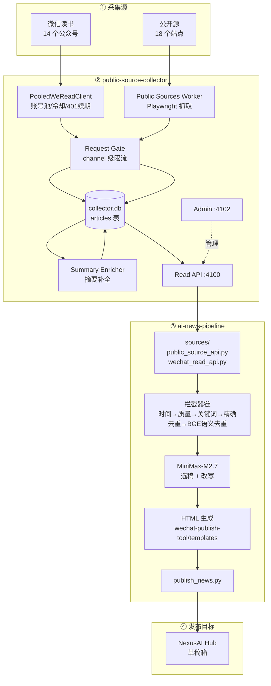

# AI 资讯日报系统 · 整体架构说明

> 最后更新：2026-11-10
> 适用范围：本机 macOS 每日自动运行的「采集 → 筛选 → AI 重写 → HTML → 微信公众号草稿」全链路
> 目标公众号：NexusAI Hub（`wxdef888862e3ecca1` / `gh_559efaf1658e`）

---

## 0. 一句话概括

这不是一个项目，而是 **两个独立代码仓库 + 一套 launchd 编排 + 一个微信发布目标**。
两个仓库通过本机 HTTP API（4100 端口）解耦协作，各自独立测试、独立 Git、独立发布节奏。

---

## 1. 项目数量与职责边界

| # | 项目 | 路径 | 语言/栈 | 一句话职责 |
|---|---|---|---|---|
| 1 | **public-source-collector** | `~/Developer/public-source-collector` | Python 3.11+ / FastAPI / SQLite / Alembic / Playwright | **采集与存储层**：把 18 个公开源 + 14 个微信公众号的内容抓进 `collector.db`，并对外提供只读 API |
| 2 | **ai-news-pipeline** | `~/Developer/ai-news-pipeline` | Python 3.11+ / MiniMax API / bge 模型 | **加工与发布层**：从 Collector API 拉数据 → 去重筛选 → MiniMax 改写 → 生成 HTML → 上传微信草稿 |
| 3 | macOS launchd 编排 | `~/Library/LaunchAgents/com.wangkp.ai-news.*` | plist + shell | **调度层**：4 个定时/常驻作业，把上面两个串成每日流水线 |
| 4 | NexusAI Hub 公众号 | 微信侧 | — | **发布目标**：接收草稿（不群发） |

### 1.1 为什么拆成两个项目

- **职责正交**：Collector 只管"拿到什么"（抓取、鉴权、频控、落库）；Pipeline 只管"做什么"（筛选、改写、排版、发布）。
- **运行边界**：Pipeline 永远不直接请求微信，只读 Collector 已落库的数据（Collector 设计决策 D-03）。
- **技术栈隔离**：Collector 需要 Playwright、微信签名算法、加密凭据库；Pipeline 需要 LLM 客户端和 HTML 模板。混在一起两边都难测。
- **可独立演进**：微信接口变了只改 Collector；Prompt 或排版变了只改 Pipeline。

---

## 2. 目录结构（开发副本 vs 运行副本）

macOS TCC 限制 launchd 后台进程读取 `~/Documents`，所以**必须**分两套副本：

| 角色 | Pipeline | Collector | 说明 |
|---|---|---|---|
| 开发副本（Git 仓库） | `~/Documents/tools/ai-news-pipeline` | `~/Documents/wechat-paper-collect/public-source-collector` | 改代码、跑测试、提交 Git |
| 运行副本（launchd 执行） | `~/Developer/ai-news-pipeline` | `~/Developer/public-source-collector` | launchd 实际执行的代码，有 `.venv`、数据库、日志 |

同步脚本：`scripts/macos/sync_runtime.sh`（用 `rsync --delete` 从开发副本推到运行副本，排除 `.venv`/`.git`/`data`/`logs`/`output`）。

```
~/Developer/
├── ai-news-pipeline/                    # 运行副本 · 加工发布层
│   ├── src/
│   │   ├── main.py                      # CLI 入口（--no-publish）
│   │   ├── pipeline.py                  # 主流程编排（run_pipeline）
│   │   ├── config.py                    # 配置加载（config.yaml + secrets.yaml）
│   │   ├── storage.py                   # news.db 存储层
│   │   ├── models.py                    # NewsItem 等领域模型
│   │   ├── time_utils.py                # 报告窗口（昨日~今日）
│   │   ├── sources/                     # 数据源适配器
│   │   │   ├── base.py
│   │   │   ├── public_source_api.py     # 公开源 → Collector API
│   │   │   ├── wechat_read_api.py       # 微信文章 → Collector API
│   │   │   ├── portals.py               # 门户型站点
│   │   │   └── github.py
│   │   ├── interceptors/                # 过滤器
│   │   │   ├── dedup.py                 # 精确去重
│   │   │   ├── bge_dedup.py             # BGE 语义去重
│   │   │   └── keyword_filter.py        # 关键词过滤
│   │   ├── llm/
│   │   │   ├── minimax.py               # MiniMax 客户端（选稿+改写）
│   │   │   └── prompts.py               # Prompt 模板
│   │   ├── publisher.py                 # 调 wechat-publish-tool
│   │   ├── console/                     # 控制台 Web
│   │   └── aggregator.py
│   ├── wechat-publish-tool/             # 发布工具（vendor 子目录）
│   │   ├── publish_news.py              # 官方 draft/add 上传 + normalize_wechat_links()
│   │   ├── cover.jpg                    # ★ 常驻封面（历史文章同款）
│   │   └── output/news_YYYYMMDD.html    # 生成的 HTML
│   ├── config.yaml                      # 非敏感配置
│   ├── secrets.yaml                     # 敏感配置（mode 600）
│   ├── data/news.db                     # Pipeline 自己的 SQLite
│   └── scripts/macos/                   # launchd wrapper + 运维脚本
│
└── public-source-collector/             # 运行副本 · 采集存储层
    ├── src/wechat_list_collector/
    │   ├── entrypoints/
    │   │   ├── read_api.py              # ★ 4100 只读 API
    │   │   ├── admin_app.py             # ★ 4102 管理台
    │   │   └── worker.py                # 采集 Worker
    │   ├── application/
    │   │   ├── collection_runner.py      # 采集编排
    │   │   ├── worker.py                 # 队列消费
    │   │   ├── summary_enricher.py       # 摘要补全（采集时）
    │   │   ├── summary_backfill.py       # 摘要补全（回填）
    │   │   ├── summary_service.py
    │   │   ├── report_window.py
    │   │   ├── read_models.py / public_read_models.py
    │   │   └── account_search.py / login_coordinator.py
    │   ├── infrastructure/
    │   │   ├── credential_vault.py       # 加密凭据库
    │   │   ├── request_gate.py           # 限流闸门
    │   │   └── weread/                  # 微信读书采集通道
    │   │       ├── weread_client.py      # 请求 + 401 自动续期 + 短链规范化
    │   │       ├── account_pool.py       # 14 账号池 + 冷却 + 换号重试
    │   │       └── weread_auth.py        # Android 签名 + token 刷新
    │   └── domain/                      # 模型、枚举、错误
    ├── data/collector.db                 # ★ 采集库（articles 表等）
    ├── migrations/                       # Alembic 迁移
    ├── public-sources.toml               # 18 个公开源定义
    ├── collector.toml                    # 本机配置（凭据加密文件路径等）
    └── tests/                            # 78 个测试
```

---

## 3. 整体数据流



### 3.1 两条采集链路

**链路 A · 微信公众号（主生产路径）**

```
微信读书账号池（14 个）
  → PooledWeReadClient        账号池轮换 / 冷却 / 换号重试
  → weread_client.py          /mp/cover → /article/list → /review/single
  → channel-scoped Request Gate   每个 channel 独立 12s 间隔 + 3–8s jitter
  → articles 表               落库（含 mp.weixin.qq.com 原文链接）
  → Summary Enricher          mpInfo.content 作为摘要；缺摘要走 backfill
```

**链路 B · 公开源（补充广度）**

```
public-sources.toml（18 个：爱范儿 / Google AI / OpenAI / 量子位 / 机器之心 / 新智元 /
                     虎嗅 / AIBase / 智东西 / 千问 / 通义 / 豆包 / 字节 Seed /
                     字节技术团队 / HarmonyOS / Android / Apple Developer / InfoQ）
  → Playwright 抓取（含 JS 渲染 + 反爬）
  → articles 表
```

### 3.2 Pipeline 内部处理链

| 阶段 | 代码位置 | 输出 |
|---|---|---|
| 1. 拉取 | `collect_all_sources()` | 186 raw items |
| 2. 时间窗口过滤 | `filter_recent()` | 昨日 00:00 ~ 今日 00:00（Asia/Shanghai） |
| 3. 质量过滤 | `quality_filter()` | 缺摘要/正文等降级进 review list |
| 4. 关键词过滤 | `keyword_filter()` | 排除招聘/融资等非技术内容 |
| 5. 精确去重 | `exact_dedup()` | 标题+URL |
| 6. 语义去重 | `bge_dedup()` | bge-small-zh-v1.5，阈值 0.85 |
| 7. AI 选稿 | `llm.select_items()` | 16–19 selected |
| 8. AI 改写 | `llm.rewrite_items()` | 每篇 MiniMax 重写标题+导读 |
| 9. 生成 HTML | `publisher.render_wechat_html()` | `output/news_YYYYMMDD.html` |
| 10. 上传草稿 | `publisher.publish_to_wechat_tool()` | NexusAI Hub 草稿 |

HTML 固定结构（用户已验收，勿擅自改动）：

```
🔥 今日热点
🏷️ AI资讯 / 🷂️ 智能硬件
  每篇：MiniMax 重写导读 + 来源账号 + 相对发布时间 + 原文链接
💡 今日洞察
来源行 · 整理：Valkyrie | date
版权声明页脚
```

---

## 4. launchd 作业编排

| Label | 类型 | 触发时间 | 作用 | 当前状态 |
|---|---|---|---|---|
| `com.wangkp.ai-news.daily-report` | 定时 | **08:00**（Hour=8, Minute=0） | 微信采集 → 摘要回填 → 公开源刷新 → Pipeline → 草稿 | 已加载（未到点） |
| `com.wangkp.ai-news.collector-refresh` | 定时 | **23:50** | 刷新 18 个公开源（提前备料） | 已加载（未到点） |
| `com.wangkp.ai-news.collector-api` | 常驻 | 开机 | Collector Read API :4100 | ✅ 运行中 (PID 31347) |
| `com.wangkp.ai-news.console` | 常驻 | 开机 | 管理控制台 :4102 | ✅ 运行中 (PID 16890) |

### 4.1 每日时间线

```
23:50  collector-refresh  →  刷新 18 个公开源（约 180–220s）
        ↓
08:00  daily-report
        ├─ sleep 0–120s 随机抖动（避免整点同一秒）
        ├─ run_wechat_collect.sh
        │    ├─ enqueue collect-all --business-date <Asia/Shanghai 日期>
        │    ├─ worker --once 循环（最多 30 轮，读 JSON 的 processed 字段判断队列空）
        │    └─ backfill-summaries --limit 60
        └─ run_pipeline.sh
             ├─ 拉 4100 /api/v1/pipeline/articles（公开源，timeout 420s）
             ├─ 拉 4100 /api/v1/pipeline/wechat/articles（微信，timeout 60s）
             ├─ 过滤 → MiniMax → HTML
             └─ 上传 NexusAI Hub 草稿
```

### 4.2 launchd 硬性约束（踩过的坑）

1. **wrapper 脚本必须 mode 755**，否则 launchd 报 `Missing executable detected`，退出码 78 (EX_CONFIG)，且会进入「惩罚箱」，后续 `chmod` 也救不回来，必须重新 `launchctl bootout` + `bootstrap`。
2. **所有 plist 路径必须指向 `~/Developer`**（运行副本），不能指向 `~/Documents`。
3. `run_wechat_collect.sh` 里 `worker --once` **永远 exit 0**，必须读 stdout JSON 的 `"processed":true` 判断队列是否空；只看 exit code 会空转满 30 轮。
4. 公开源刷新实测 180–220s，`request_timeout_seconds` 必须 ≥ 420（180 会超时）。
5. `manage_services.sh` 的 bootout 是异步的，需要等待；且单个 job 失败不能中断其他 job。

---

## 5. 发布链路（只进草稿箱，不群发）

```
publish_news.py
  → normalize_wechat_links()        只对微信链接做 ~ → _
  → material/add_material?type=thumb   上传封面
  → draft/add                        创建草稿
  → draft/get                        回读核验
```

### 5.1 关键规则

| 规则 | 原因 |
|---|---|
| **封面必须用 `wechat-publish-tool/cover.jpg`** | 与 NexusAI Hub 历史文章同一张（SHA 前缀 `b937aa4779a3`，与历史草稿完全一致）。曾误用 `openclaw-skills/cover.jpg` 的裁图，RMS 差异 ~111 |
| **微信短链 `~` 必须转 `_`** | 微信短链字符集只允许 `[A-Za-z0-9_-]`，含 `~` 会被 `draft/add` 拒绝（ret 64550）。`short_id_from_review_id()` 按 `MP_WXS_{uin}_{shortid}` 解析并规范化 |
| **只创建草稿，不正式群发** | `freepublish` / `message/mass/sendall` 返回 `errcode=48001`；用户明确只需草稿箱 |
| **AI 声明只能在后台编辑器设置** | 官方 `draft/add` 不支持 `claim_source_type` 字段。当前草稿未设置该声明 |
| **AppSecret 只从 `secrets.yaml` 读** | 文件 mode 600，日志/摘要一律 `[REDACTED]` |

### 5.2 当前最终草稿状态

```
账号     = NexusAI Hub (wxdef888862e3ecca1)
标题     = 移动端AI资讯速览 | 2026-11-10
作者     = Valkyrie
正文     ≈ 9700 字符
微信链接 = 3 个短链，0 个含 ~
封面     = SHA 前缀 b937aa4779a3（与历史封面完全一致）
当日草稿 = 1 个（手动+launchd 跑过两次，已去重）
正式发布 = 否
```

---

## 6. 数据层

| 数据库 | 位置 | 内容 | 备份 |
|---|---|---|---|
| `collector.db` | `~/Developer/public-source-collector/data/` | `articles` 347 篇 · `official_accounts` 14 · `public_sources` 18 · `public_endpoint_runs` 149 · `wechat_requests` 103 · `request_channel_state` 2 | `collector.db.bak_urlfix_<ts>`（mode 600） |
| `news.db` | `~/Developer/ai-news-pipeline/data/` | `runs` 19 · `raw_items` 2072 · `processed_items` 806 | — |
| 凭据 Vault | `~/Developer/public-source-collector/data/credentials.enc`<br>`~/Developer/public-source-collector/data/weread_credentials.enc` | 加密存储微信读书账号池 | — |
| `secrets.yaml` | `~/Developer/ai-news-pipeline/` | AppID/AppSecret/MiniMax key（mode 600） | — |
| `local-machine.env` | `~/Developer/ai-news-pipeline/deploy/macos/` | 环境变量与开关（mode 600） | — |

Collector 用 Alembic 管理迁移，当前 head = `20260810_10`（channel-scoped request state）。
`articles.source_article_id` = 微信 `reviewId` = `article.id`，是三个 ID 的唯一锚点。

---

## 7. 凭据与频控纪律

### 7.1 微信读书错误码处理

| 错误 | 含义 | 处置 |
|---|---|---|
| HTTP 401 / `errcode=-2012` | accessToken 过期 | 用 `refreshToken` 静默换新 → 重试一次 |
| `errcode=-2014` | 频控 | **不是认证失败**。退避 1.5s 只重试一次，随后停止并冷却账号 300s |
| `QR_UNAVAILABLE` | 二维码未就绪 | 轮询等待；PNG 用 magic bytes `89504e47` 判定 |
| `expired / PROCESS_RESTARTED` | 扫码会话失效 | 微信 admin 同时只能跑一个实例 |

**关键纪律**：`-2014` 如果被误判成认证失败去换号，会把整个账号池打死。

### 7.2 续期写回

多账号续期后必须**按账号标识合并**回 vault，不能用单账号列表覆盖整个 vault。

### 7.3 摘要补全预算

- 列表请求与摘要请求共用 `weread_reader` channel 的 12s 最小间隔 + 3–8s jitter
- 摘要以 `operation="article_summary"` 单独计数
- `/review/single` 只能单篇调用（批量参数返回 HTTP 499）
- 采集时 enricher 每页只填 `max_items_per_page=2` 篇摘要 → 需要 `backfill-summaries` 回填
- 已有非空摘要**不能**被空摘要覆盖
- 摘要 enrichment 失败不得拖垮已完成的列表采集

---

## 8. Git 仓库与远端同步

| 仓库 | 远端 | 分支 | 最新提交 | 测试 | 状态 |
|---|---|---|---|---|---|
| ai-news-pipeline | `git@github.com:MyKPWang/ai-news-pipeline.git` | `codex/public-source-pipeline` | `20d64b9` Wire macOS launchd deployment and WeChat draft publishing | 45/45 | ✅ 已推送 |
| public-source-collector | `git@github.com:MyKPWang/public-source-collector.git` | `main` | `acd966d` Add WeChat Reading article collection and digest enrichment | 78/78 | ✅ 已推送 |

### 8.1 GitHub 连接方式

```bash
GIT_SSH_COMMAND='ssh -p 443 -o HostName=ssh.github.com -o StrictHostKeyChecking=accept-new'
```

- 本机 22 端口不通，443 可用，认证身份 `MyKPWang`
- **不修改 `~/.ssh/config`**（未获授权），每次命令内联
- GitHub OAuth device flow 换来的 token 是 GitHub App 用户令牌（`ghu_`），能读写已有仓库但**不能创建新仓库**（`POST /user/repos` → 403）
- 新仓库通过已登录的 Chrome 会话在 `github.com/new` 页面创建

### 8.2 提交前安全检查

必须排除：`data/`、`.venv/`、`*.enc`、`collector.toml`、`collector.db`、`secrets.yaml`、`local-machine.env`、`logs/`、`output/`、`.codegraph/`、`.playwright-cli/`、`__pycache__/`、`admin-accounts.png`。

提交前用真实 token 值做字符串扫描，确认出现次数为 **0**。任何 AppSecret / token / password 不得进入提交或日志。

---

## 9. 运维

### 9.1 常用命令

```bash
# 服务管理
~/Developer/ai-news-pipeline/scripts/macos/manage_services.sh {status|restart|stop|start}

# 健康检查
curl -s http://127.0.0.1:4100/health/ready          # {"status":"ready"}
curl -s -o /dev/null -w '%{http_code}\n' http://127.0.0.1:4102/console   # 200

# 手动跑一次完整日报
~/Developer/ai-news-pipeline/scripts/macos/run_pipeline.sh

# 同步开发副本 → 运行副本
~/Developer/ai-news-pipeline/scripts/macos/sync_runtime.sh

# 看定时任务
launchctl list | grep wangkp
```

### 9.2 常见故障

| 症状 | 原因 | 处理 |
|---|---|---|
| launchd 报 `Missing executable detected` / 退出 78 | wrapper 不是 755 | `chmod 755` **且** `bootout` + `bootstrap` 重载 |
| `Read timed out (180)` | 公开源刷新要 180–220s | `request_timeout_seconds` → 420 |
| 草稿正文里的微信链接点不开 | 含 `~` | 跑 `backfill`/修复后重推 |
| 草稿封面和历史文章不一样 | 用了裁图 | 只用 `wechat-publish-tool/cover.jpg` |
| 采集整体卡死 | 旧全局冷却阻塞 reader channel | 用 channel-scoped gate（已修） |
| 401 循环 | token 过期未续期 | 检查 `weread_auth.py` 续期路径 |
| 草稿建到了 `xAiLabratory` | AppID 配错 | 必须是 `wxdef888862e3ecca1` |

### 9.3 日志位置

```
~/Developer/ai-news-pipeline/logs/
├── app_YYYYMMDD.log
├── llm_YYYYMMDD.jsonl
├── daily-report.launchd.log / .error.log
└── collector-refresh.launchd.log / .error.log
```

---

## 10. 能力边界（当前明确不支持）

| 能力 | 状态 | 说明 |
|---|---|---|
| 自动创建草稿 | ✅ 支持 | `draft/add` / `draft/update` / `material/add_material` |
| 正式群发 | ❌ 不支持 | `freepublish`、`message/mass/sendall` 均 `errcode=48001` |
| 草稿内 AI 生成声明 | ❌ 不支持 | 官方 API 无 `claim_source_type` 字段，需后台编辑器手动设置 |
| `material/add_news` | ❌ 不支持 | `errcode=40113 unsupported file type` |
| 公众号后台直接采文章 | ❌ 已放弃 | `appmsgpublish` 返回 `ret=200013`；改走微信读书 |
| 抓取微信正文全文 | ✅ 支持 | `https://weread.qq.com/web/mp/content?reviewId=...` |

---

## 11. 相关文档

| 文档 | 位置 | 用途 |
|---|---|---|
| 本文档 | `ai-news-pipeline/docs/SYSTEM_ARCHITECTURE.md` | 整体框架（你正在看的） |
| 本机运维手册 | `ai-news-pipeline/docs/LOCAL_MACOS_RUNBOOK.md` | 排障、部署细节、发布步骤 |
| Collector 设计 | `public-source-collector/ARCHITECTURE.md` | 采集侧详细设计与锁定决策 |
| Collector 数据/API 契约 | `public-source-collector/docs/DATA_AND_API_CONTRACTS.md` | 表结构、接口精确定义 |
| 运维 Skill | Hermes skill `ai-news-pipeline-macos-ops` | 自动化运维流程 |

---

## 附录 A · 一次完整运行的实测数字（2026-11-10）

```
launchd kickstart 实跑：
  run_id=19
  186 raw → 16 selected → 16 publishable → 40 review
  html_path=wechat-publish-tool/output/news_20261110.html
  published=True

微信采集（14 账号）：
  347 篇文章入库
  46 次列表请求
  14 次摘要请求

Collector 库现状：
  articles 347 · official_accounts 14 · public_sources 18
  public_endpoint_runs 149 · wechat_requests 103 · collection_runs 11

URL 修复：
  88 条含 ~ 的坏链接 → 88 条已修复 → 剩余 0
  347 条重建校验 0 mismatch
```

## 附录 B · 14 个已订阅公众号

以下为 `collector.db` 中 `official_accounts` 表的实际 14 个账号：

量子位、新智元、机器之心、智东西、APPSO、千问大模型、通义实验室、Android 开发者、
HarmonyOS开发者技术、Apple 开发者、豆包、千问APP、字节跳动技术团队、AI前线

> 注：微信读书通道的账号由扫码登录获得，与最初规划关注的公众号名单不完全一致；
> 公开源侧的 `public-sources.toml`（18 个站点）另行维护，两者是互补关系。
